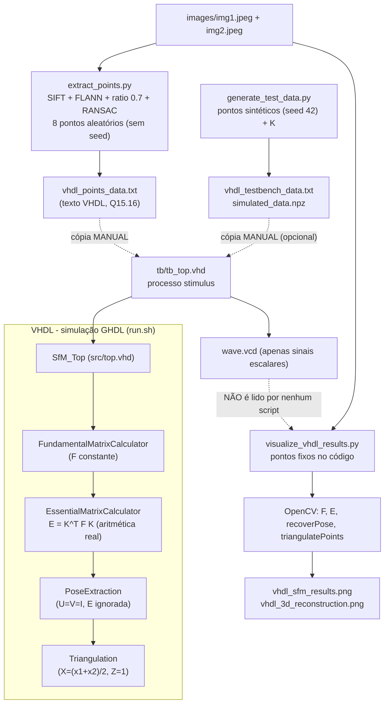

# Structure from Motion (SfM) em VHDL

Protótipo de um pipeline de Structure from Motion para duas vistas, descrito em VHDL (simulação com GHDL), acompanhado de scripts Python/OpenCV que extraem correspondências de pontos, geram código VHDL de estímulo e produzem visualizações.

> **Estado real do projeto (resumo):** o VHDL implementa a **estrutura** do pipeline (módulos, interfaces, máquinas de estados e handshake entre etapas), mas a maior parte dos algoritmos numéricos é **placeholder**: a matriz fundamental, a SVD, a pose e a triangulação usam constantes ou aproximações que **não dependem dos pontos de entrada**. Os resultados geométricos mostrados nas imagens do repositório são calculados **em Python/OpenCV**, não pelo VHDL. Detalhes e evidências nas seções abaixo.

## Sumário

1. [Arquitetura real](#arquitetura-real)
2. [Estado de implementação por etapa](#estado-de-implementação-por-etapa)
3. [Fluxo de dados e execução](#fluxo-de-dados-e-execução)
4. [Organização do repositório](#organização-do-repositório)
5. [Pré-requisitos e instalação](#pré-requisitos-e-instalação)
6. [Como executar](#como-executar)
7. [Entradas e saídas](#entradas-e-saídas)
8. [O que foi verificado e o que não foi](#o-que-foi-verificado-e-o-que-não-foi)
9. [Limitações e inconsistências conhecidas](#limitações-e-inconsistências-conhecidas)
10. [Licença e referências](#licença-e-referências)

## Arquitetura real

O projeto tem dois blocos independentes que **não se comunicam em tempo de execução**:

| Bloco | Papel (confirmado no código) | Arquivos |
|---|---|---|
| **Python (pré-processamento)** | Detecta SIFT, casa descritores (FLANN + teste de razão 0,7), filtra outliers com RANSAC (`cv2.findFundamentalMat`), converte coordenadas para Q15.16 e **emite texto com atribuições VHDL** | `extract_points.py`, `generate_test_data.py` |
| **VHDL (simulação)** | Entidade `SfM_Top` encadeia 4 submódulos por FSM e handshake `start`/`ready`/`done`; aritmética em ponto fixo Q15.16 (`signed(31 downto 0)`) | `src/*.vhd`, `tb/tb_top.vhd` |
| **Python (visualização)** | Recalcula F, E, pose e triangulação **com OpenCV** a partir de pontos **fixos no código**, e desenha epilinhas/nuvem 3D | `visualize_vhdl_results.py` |
| **Python (referência)** | Pipeline OpenCV completo em notebook (imagens baixadas via `gdown` do Google Drive; K diferente do VHDL) | `Epipolar_Geometry.ipynb` |

Evidências:

- **Não há interface Python ↔ VHDL automática.** `extract_points.py` apenas grava `vhdl_points_data.txt` e `generate_test_data.py` grava `vhdl_testbench_data.txt`; nenhum script chama o GHDL nem lê saídas do VHDL. A transferência de dados para o VHDL é **manual** (copiar o texto para dentro do processo `stimulus` de [tb/tb_top.vhd](tb/tb_top.vhd)). Nenhum script faz essa colagem.
- **`visualize_vhdl_results.py` não lê nenhum resultado da simulação.** Os pontos estão digitados em `load_vhdl_results()` e K em `load_calibration_matrix()`; F, E, R, t e a triangulação vêm de `cv2.findFundamentalMat(..., FM_8POINT)`, `cv2.recoverPose` e `cv2.triangulatePoints` (funções `main()`). As mensagens finais do script ("Processamento: 100% VHDL", "validado com sucesso") **não são sustentadas pelo código**. Além disso, o `wave.vcd` gerado pelo GHDL **não contém** as matrizes: o VCD do GHDL registra "not handled" para sinais do tipo array (`pts1_in`, `fundamental_f`, `essential_e`, `pose_r`, `pose_t`, `points_3d`), conforme observado na execução descrita abaixo.
- **Não há aceleração por hardware demonstrada.** Não existem arquivos de síntese/implementação (XDC/QSF/projeto Vivado/Quartus), relatórios de utilização/tempo ou evidência de execução em FPGA. Só há simulação comportamental (GHDL) e VHDL com construções não sintetizáveis no caminho de dados (por exemplo, divisão `/ 2` e laços `for` em funções, que podem ou não ser aceitas por uma ferramenta de síntese — **não verificado**).



## Estado de implementação por etapa

Classificação baseada na leitura do código-fonte. "Entrada usada?" indica se a saída da etapa depende dos dados de entrada.

| Etapa (arquivo / entidade) | O que o código faz de fato | Entrada usada? | Estado |
|---|---|---|---|
| Normalização (`fundamental_matrix.vhd`, estado `NORMALIZE`) | Copia `pts1_x`/`pts2_x` para `pts1_norm`/`pts2_norm`; sem normalização de Hartley; os sinais copiados não são lidos depois | não | placeholder |
| Montagem de A (`BUILD_MATRIX`) | Executa 3 iterações (`counter < 3`) com **valores fixos** 1.0…12.0 e aproximações com `shift_right`; a matriz `A` (8×9) não é usada adiante | não | placeholder |
| Resolução / SVD (`SOLVE_SVD`) | Atribui `f_vec` = 0.5, 0.25, 0.125, … (constantes) | não | placeholder |
| Posto 2 (`ENFORCE_RANK2`) | Remodela `f_vec` em 3×3; não impõe posto 2 | não | placeholder |
| Matriz essencial (`essential_matrix.vhd`) | Calcula `E = Kᵀ·F·K` com `Mat3Mul`/`Transpose` (64 bits, truncamento `(47 downto 16)`) | sim (F e K) | **única etapa aritmética real**; a F recebida é constante (ver limitações) |
| SVD de E (`pose_extraction.vhd`, `COMPUTE_SVD`) | Define U = V = identidade e W/Wᵀ constantes | não (`E_in` não é lida) | placeholder |
| Pose (`EXTRACT_POSE`) | R1 = U·W·Vᵀ, R2 = U·Wᵀ·Vᵀ, t = ±U(:,2); escolhe a 1ª solução sem teste de cheirality | não | parcial: fórmulas corretas, mas com U, V fixos |
| Matrizes de projeção (`triangulation.vhd`, `BUILD_PROJECTION_MATRICES`) | Calcula P1 e P2 | sim | calculadas, **mas não usadas** na triangulação |
| Triangulação (`TRIANGULATE_POINTS`) | `X=(x1+x2)/2`, `Y=(y1+y2)/2`, `Z=1.0`, `W=1.0` para 100 posições (as não preenchidas têm entradas 0) | sim, mas sem geometria | placeholder |
| `SfM_Top` (`top.vhd`) | FSM `IDLE → CALC_FUNDAMENTAL → CALC_ESSENTIAL → EXTRACT_POSE → TRIANGULATE → DONE`; instancia os 4 módulos | — | implementado e exercitado em simulação |
| `algebra_pkg` | `Mat3Mul`, `Transpose`, `Mat3VecMul` são usadas. `Cross3`, `Skew`, `Normalize3` (devolve a entrada sem normalizar) e `SVD3x3` (devolve identidade) **não são chamadas** por nenhum módulo | — | parcialmente stub |
| `projective_pkg.vhd` | Pacote vazio (comentário "reservado") | — | vazio |

Pontos de referência no código: `SOLVE_SVD` em [src/fundamental_matrix.vhd](src/fundamental_matrix.vhd#L104), `COMPUTE_SVD` em [src/pose_extraction.vhd](src/pose_extraction.vhd#L47), `TRIANGULATE_POINTS` em [src/triangulation.vhd](src/triangulation.vhd#L77), `Normalize3` em [src/algebra_pkg_body.vhd](src/algebra_pkg_body.vhd#L52), `SVD3x3` em [src/algebra_pkg_body.vhd](src/algebra_pkg_body.vhd#L116).

### Formato numérico

`Q15_16` = `signed(31 downto 0)` ([src/fixed_pkg.vhd](src/fixed_pkg.vhd)): 1 bit de sinal, 15 de parte inteira, 16 fracionários; faixa de −32768 a ≈32767,99998, resolução 2⁻¹⁶. Os scripts Python convertem com `int(valor * 65536)` (truncamento), e emitem `to_signed(N, 32)`. Os tipos de matriz de pontos (`FixedArray2D`, `FixedArray3D`) têm 100 linhas fixas.

## Fluxo de dados e execução

1. **Geração de dados (Python, opcional)**
   - `extract_points.py`: lê `images/img1.jpeg` e `images/img2.jpeg` em escala de cinza → SIFT → FLANN (`knnMatch`, k=2) → razão de Lowe 0,7 → `findFundamentalMat(FM_RANSAC)` para filtrar inliers → seleciona 8 pontos com `np.random.choice` (**sem semente: o resultado muda a cada execução**) → escreve `vhdl_points_data.txt`. Não inclui a matriz K.
   - `generate_test_data.py`: gera 8 pares sintéticos (`np.random.seed(42)`) e K (fx=fy=525, cx=320, cy=240) → escreve `vhdl_testbench_data.txt` e `simulated_data.npz` (`pts1`, `pts2`, `K`).
2. **Estímulo (manual)**: o conteúdo gerado precisa ser colado em [tb/tb_top.vhd](tb/tb_top.vhd). Os pontos hoje presentes em `tb_top.vhd` são os mesmos digitados em `visualize_vhdl_results.py` e **diferem** dos atualmente salvos em `vhdl_points_data.txt` (este foi gerado por uma execução posterior e aleatória de `extract_points.py`). K em `tb_top.vhd` = 525/525/320/240.
3. **Simulação VHDL** (`run.sh`): compila pacotes → módulos → `tb_top`, elabora e executa por 10 µs gerando `wave.vcd`. Sequência do testbench: `reset` por 100 ns, `start` por 20 ns, espera `ready = '1'`, emite dois `report` e finaliza.
4. **Pipeline em `SfM_Top`** (handshake em cadeia): `fund_ready` → `ess_start`; `ess_ready` → `pose_start`; `pose_done` → `tri_start`; `tri_done` → `DONE` com `ready <= '1'`.
5. **Visualização (Python)**: `visualize_vhdl_results.py` usa pontos próprios fixos e OpenCV; grava `vhdl_sfm_results.png` e `vhdl_3d_reconstruction.png` (também chama `plt.show()`, que exige backend gráfico).

Sequência temporal observada no `wave.vcd` da simulação (ver verificação): `fund_ready` em 215 ns, `ess_ready` em 235 ns, `pose_done` em 285 ns, `tri_done` em 1335 ns (100 iterações de triangulação, uma por ciclo de 10 ns) e `ready` em 1355 ns.

## Organização do repositório

```
structure_from_motion/
├── src/                       # VHDL (código próprio)
│   ├── fixed_pkg.vhd          # tipo Q15_16 e tipos de vetor/matriz
│   ├── algebra_pkg.vhd        # declarações (Mat3Mul, Cross3, Normalize3, Transpose, Mat3VecMul, Skew, SVD3x3)
│   ├── algebra_pkg_body.vhd   # implementações (Normalize3 e SVD3x3 são stubs)
│   ├── projective_pkg.vhd     # pacote vazio
│   ├── fundamental_matrix.vhd # FundamentalMatrixCalculator (placeholder)
│   ├── essential_matrix.vhd   # EssentialMatrixCalculator (E = Kᵀ F K)
│   ├── pose_extraction.vhd    # PoseExtraction (U=V=I)
│   ├── triangulation.vhd      # Triangulation (placeholder)
│   └── top.vhd                # SfM_Top (FSM + instâncias)
├── tb/
│   ├── tb_top.vhd             # testbench usado por run.sh
│   └── tb_fundamental.vhd     # testbench isolado da matriz fundamental (não usado por run.sh)
├── images/img1.jpeg, img2.jpeg  # 640×480 (verificado com OpenCV: shape 480×640)
├── extract_points.py          # SIFT/FLANN/RANSAC → texto VHDL
├── generate_test_data.py      # dados sintéticos → texto VHDL + .npz
├── visualize_vhdl_results.py  # visualização com OpenCV (não lê saída do VHDL)
├── Epipolar_Geometry.ipynb    # referência OpenCV (Colab; baixa imagens via gdown)
├── SfM.txt                    # pseudocódigo em português do pipeline OpenCV do notebook
├── run.sh                     # compila, elabora e simula tb_top com GHDL
├── setup_env.sh               # cria .venv e instala opencv-python, numpy, matplotlib
├── vhdl_points_data.txt       # saída de extract_points.py (gerada; aleatória)
├── vhdl_testbench_data.txt    # saída de generate_test_data.py (gerada)
├── simulated_data.npz         # saída de generate_test_data.py (gerada)
├── vhdl_sfm_results.png, vhdl_3d_reconstruction.png  # saídas de visualize_vhdl_results.py (OpenCV)
└── tb_top                     # executável ELF do GHDL versionado no git (artefato de build)
```

Arquivos gerados em tempo de execução e ignorados pelo git ([.gitignore](.gitignore)): `work/`, `*.cf`, `*.o`, `*.vcd`, `.venv`. Os arquivos VHDL estão em codificação não UTF-8 (acentos dos comentários aparecem corrompidos em editores UTF-8); isso não afeta a compilação.

## Pré-requisitos e instalação

- **GHDL** (simulador VHDL) — versão usada pelo autor não está registrada no repositório. O GHDL **não estava instalado** no ambiente onde esta documentação foi auditada.
- **Python 3 + OpenCV (com `SIFT_create`), NumPy, Matplotlib** — `setup_env.sh` instala `opencv-python numpy matplotlib` sem versões fixas (não há `requirements.txt`). Na auditoria foram usadas as versões OpenCV 5.0.0 (headless), NumPy 2.2.6, Matplotlib 3.10.9, Python 3 (WSL Ubuntu 22.04).
- **GTKWave** (opcional) para abrir `wave.vcd`; não é referenciado por nenhum script.
- Os scripts `.sh` requerem Bash (Linux/WSL).

```bash
./setup_env.sh            # cria .venv e instala dependências Python
source .venv/bin/activate
```

## Como executar

```bash
# Simulação VHDL (requer GHDL no PATH). Gera work/ e wave.vcd
./run.sh

# Gerar pontos reais a partir das imagens (saída: vhdl_points_data.txt; resultado aleatório)
python3 extract_points.py

# Gerar pontos sintéticos (saídas: vhdl_testbench_data.txt, simulated_data.npz)
python3 generate_test_data.py

# Gerar figuras (usa OpenCV, não resultados do VHDL; requer backend gráfico por causa de plt.show())
python3 visualize_vhdl_results.py
```

Para simular com outros pontos, cole o conteúdo de `vhdl_points_data.txt` (ou `vhdl_testbench_data.txt`, que também inclui K) no processo `stimulus` de `tb/tb_top.vhd`, substituindo os blocos de atribuição correspondentes, e rode `./run.sh` novamente.

Saída esperada de `./run.sh` na etapa de simulação (mensagens do testbench, confirmadas ao executar o binário `tb_top` versionado):

```
tb/tb_top.vhd:142:9:@1455ns:(report note): Teste SfM completo executado com sucesso!
tb/tb_top.vhd:143:9:@1455ns:(report note): Pipeline executado: Fundamental -> Essential -> Pose -> Triangulation
```

Atenção: essa mensagem indica apenas que o handshake terminou (`ready = '1'`); o testbench **não compara** nenhuma saída com valores esperados.

Teste isolado (`tb_fundamental`) não é executado por `run.sh`; os comandos GHDL correspondentes não foram verificados.

## Entradas e saídas

| Item | Formato | Origem/Destino |
|---|---|---|
| Pontos (`pts1_in`, `pts2_in`) | `FixedArray2D`, Q15.16, colunas (x, y) em pixels, 100 linhas (8 usadas no testbench) | atribuídos em `tb_top.vhd` |
| Calibração `K_matrix` | `Mat3`, Q15.16 | atribuída em `tb_top.vhd` (525, 525, 320, 240) |
| Saídas de `SfM_Top` | `fundamental_F`, `essential_E`, `pose_R` (`Mat3`), `pose_t` (`Vec3`), `points_3D` (`FixedArray3D`, X, Y, Z, W), `ready` | sinais do testbench; **não exportados** para arquivo |
| `wave.vcd` | VCD do GHDL | contém apenas sinais escalares (clk, reset, start, ready, estados de handshake) |

## O que foi verificado e o que não foi

**Verificado nesta auditoria**

- Leitura integral de todos os arquivos `.vhd`, `.py`, `run.sh`, `setup_env.sh`, `.gitignore`, `SfM.txt` e do notebook.
- Execução do binário `tb_top` (ELF versionado) com `--stop-time=10us --vcd=...` em cópia temporária (WSL): terminou com as duas mensagens `report` acima em 1455 ns; o VCD mostrou a sequência de handshake citada. As linhas 142/143 do relatório coincidem com o `tb/tb_top.vhd` atual. O binário **não foi recompilado** a partir do código-fonte, portanto não se pode garantir que corresponda exatamente aos `.vhd` atuais.
- Execução de `extract_points.py`, `generate_test_data.py` e `visualize_vhdl_results.py` em cópia temporária com um venv isolado e `MPLBACKEND=Agg`: os três concluíram. `extract_points.py` encontrou 1199 e 1494 keypoints, 137 correspondências após o teste de razão e 129 inliers após RANSAC, e selecionou 8. Nessa execução, o OpenCV retornou R próxima da identidade (com ≈16° de rotação em torno de Y) e t ≈ (−0,40, 0,17, −0,90) para os pontos do testbench — valores que **não** coincidem com o que o código VHDL produz (ver abaixo).

**Não verificado**

- `run.sh` completo (compilação com GHDL): GHDL não está instalado no ambiente de auditoria.
- Valores numéricos das saídas `fundamental_F`, `essential_E`, `pose_R`, `pose_t` e `points_3D` em simulação: o VCD do GHDL não exporta arrays e o testbench não os imprime.
- Qualquer síntese, uso de recursos (LUT/DSP/BRAM), frequência máxima ou execução em FPGA: não há evidência no repositório.
- Comandos `ghdl` isolados, `tb_fundamental` e uso do GTKWave.

## Limitações e inconsistências conhecidas

Derivadas de análise estática do código (confirmadas por leitura; não por simulação com inspeção de valores):

1. **F, R e t não dependem das entradas.** F vem de constantes (`SOLVE_SVD`); R e t decorrem de U = V = I (R = W, t = (0, 0, 1) em Q15.16, se os sinais estivessem corretamente propagados).
2. **Possíveis valores indefinidos em F e pose.** Em `ENFORCE_RANK2` (`F_out <= F_temp`, [src/fundamental_matrix.vhd](src/fundamental_matrix.vhd#L125)) e em `EXTRACT_POSE` (`R_temp <= R1`, [src/pose_extraction.vhd](src/pose_extraction.vhd#L94)), os sinais lidos foram atribuídos no mesmo ciclo; pela semântica de sinais do VHDL a leitura retorna o valor anterior (inicialmente `'U'`). Consequentemente `F_out`, `R_out` e `t_out` podem permanecer indefinidos e propagar `'X'` para `E`. O pipeline termina normalmente porque o handshake não depende desses valores. Para confirmar é necessário GHDL e um testbench que imprima/compare as saídas.
3. A triangulação **não é DLT**: P1/P2 são calculadas mas ignoradas; as coordenadas 3D são médias de coordenadas de pixel com Z = 1.
4. O testbench não possui verificação automática (nenhum `assert` de valores).
5. Capacidade: os tipos suportam até 100 pontos, mas a matriz fundamental ignora as entradas e a triangulação sempre percorre 100 posições (as não preenchidas contribuem com zeros).
6. `extract_points.py` é não determinístico e não emite K; `visualize_vhdl_results.py` tem pontos fixos que não acompanham `vhdl_points_data.txt`.
7. As mensagens finais de `visualize_vhdl_results.py` ("100% VHDL", "validado com sucesso") não correspondem ao que o script faz.
8. `Epipolar_Geometry.ipynb` usa K = [[1000,0,640],[0,980,360],[0,0,1]], LMEDS e razão 0,8, diferentes dos scripts do repositório (K = 525/320/240, RANSAC, razão 0,7).
9. `SfM.txt` é pseudocódigo do pipeline OpenCV do notebook (SIFT/FLANN/F/drawlines); não descreve o VHDL.

### Trabalho futuro (não implementado)

Itens necessários para que o VHDL realize de fato SfM a partir dos pontos: construção de A a partir das entradas, solução do sistema/SVD (ou equivalente), imposição de posto 2, normalização de Hartley, SVD de E, seleção da pose por cheirality, triangulação linear com P1/P2, testbench autoverificável e comparação numérica com OpenCV, além de qualquer fluxo de síntese. Esta lista descreve lacunas observadas, não um roteiro comprometido.

## Licença e referências

[LICENSE](LICENSE): texto da Unlicense (domínio público).

Referências citadas na versão anterior deste README (não usadas diretamente no código):

1. Hartley & Zisserman — *Multiple View Geometry in Computer Vision*
2. Ma et al. — *An Invitation to 3-D Vision*
3. Documentação do OpenCV
4. Guia do GHDL
