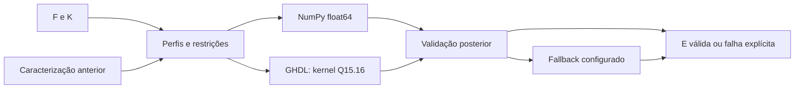

# Metodologia experimental

## Pergunta e hipóteses

Em quais condições perfis medidos anteriormente permitem selecionar uma
implementação viável de `E = KᵀFK`, e qual é o custo da decisão diante de políticas
fixas? São verificáveis: (H1) a previsão por perfis permite escolhas viáveis em
casos não usados na caracterização; (H2) o overhead de seleção pode exceder o
próprio cálculo NumPy de uma matriz 3×3. Resultados contrários devem ser preservados.
Não se pressupõe ganho de velocidade ou originalidade da política.

## Arquitetura e baselines

Os backends recebem as mesmas matrizes, sem normalização automática. Software
usa `K.T @ F @ K` em float64. RTL usa `EssentialMatrixCalculator` simulado em
GHDL, duas multiplicações Q15.16 com soma signed64, truncamento e wrap. O modelo
inteiro independente reproduz os wraps explicitamente em inteiros Python.

Políticas fixas sempre tentam seu backend e verificam os limites posteriormente,
sem fallback. `auto` exige perfil compatível, ausência de falhas de caracterização,
erro/tempo previstos dentro dos limites e disponibilidade. Depois aplica
`min_time` ou `prefer_rtl`; empate de tempo escolhe software. Compara os maiores
erro e tempo observados, sem pontuação energética ou recursos FPGA inventados.

O caso corrente não é executado antes da decisão para obter seu erro. A
comparação NumPy/modelo/RTL da Etapa 1 integra o custo do backend e ocorre depois
de sua escolha. Fallback mantém a falha original no registro e respeita o
orçamento restante. Detalhes do contrato em [GERENCIADOR.md](GERENCIADOR.md).

## Dados e separação

O gerador produz 59 casos: 33 de caracterização, 10 de desenvolvimento e 16 de
avaliação. IDs e sementes são persistidos. Matriz K pode se repetir entre casos,
mas F/correspondências finais não alimentam os perfis. Há três categorias:

- **Controle numérico:** amplitudes limitadas, sinais mistos, entradas pequenas,
  extremos signed32, overflow result32 e overflow do acumulador64. As fronteiras
  de algumas classes são incluídas no treino por desenho prévio, permitindo
  testar interpolação. São testes aritméticos, não reconstruções físicas nem
  evidência de benefício de desempenho em aplicações.
- **Câmeras sintéticas calibradas:** pontos 3D têm profundidade positiva em duas
  câmeras conhecidas. `E_gt=[t]×R` e `F=K⁻ᵀ E_gt K⁻¹`. As correspondências vêm
  da projeção desses mesmos pontos; resíduos epipolares e profundidades são
  verificados. A referência E_gt independe da multiplicação NumPy KᵀFK. K=525/320/240
  tem significado físico somente no cenário sintético que a define.
- **Imagens do repositório:** o pipeline existente SIFT/FLANN/razão 0,7/RANSAC
  extrai os inliers, com sementes NumPy/OpenCV e um thread. Os IDs dos matches
  são separados em três pools disjuntos; F é estimada com FM_8POINT por subconjunto.
  K=525/320/240 é estimada, sem calibração real documentada. Uma única cena e
  nenhum ground truth impedem afirmações de precisão métrica.

O RANSAC inicial usa todos os matches do par antes da separação. É uma limitação
de pré-processamento compartilhado e não torna os splits cenas independentes.
Parâmetros padrão da versão OpenCV e hash do extrator ficam no manifesto.
O mínimo de 96 inliers permite quatro grupos de treino com pelo menos oito pares.
Se não houver dados suficientes, o programa interrompe e registra a condição.

## Configuração congelada

`experiments/config.json` é salvo e recebe hash antes das medidas. Contém sementes,
duas repetições independentes, um aquecimento, duas repetições dos perfis, cinco
temporais e duas por política/caso/requisito. Percentis por população recebem
seus tamanhos amostrais; p95 com poucas observações não é estimativa de cauda rara.

Cinco cenários são anteriores à avaliação: precisão estrita (1e-6), balanceado
(0,01), preferência RTL (0,01), orçamento de 5 ms e requisito impossível de tempo
zero. Os dois últimos usam o mesmo contrato de erro declarado na configuração.
O cenário padrão é escolhido somente no desenvolvimento por maior número de
sucessos, menor tolerância e ID, e congelado antes de qualquer caso final. Todos
os cinco cenários continuam relatados, sem escolher apenas o mais favorável.

## A — Métricas numéricas

Para R=KᵀFK float64 e V=resultado exportado:

- Erro absoluto: `a = max_ij |V_ij - R_ij|`.
- Erro relativo: `a / max_ij |R_ij|` quando o denominador excede 1e-12. Abaixo
  desse limiar, usa-se zero por convenção se também `a<=1e-12`; caso contrário
  o valor fica indefinido (`null`). A convenção e a condição são registradas.
- Diferença inteira: maior `|raw_RTL - raw_modelo|`, sem tolerância. Também há
  hashes das nove componentes e lista de eventos de overflow.
- Erro de forma: `min(||V/||V||F - R/||R||F||F, ||V/||V||F + R/||R||F||F)`
  para dados geométricos e matrizes com norma acima do limiar. Trata escala e
  sinal. Se alguma matriz for nula, fica indefinido, nunca zero artificialmente.
- No sintético, registra-se também a diferença float64 contra E_gt conhecida.

Equivalência inteira com overflow continua inválida. Ausência de overflow não
assegura forma geométrica adequada: quantizar componentes pequenas de F pode
zerá-las. Casos com K estimada não têm referência métrica independente real.

## B — Tempos

`perf_counter` mede parede, em segundos. Cada repetição começa com uma compilação
fria separadamente registrada. Perfis têm aquecimento e reusam esse cache; as
medidas finais também usam o cache. A ordem de casos/backends/políticas varia
por semente explícita, sem escolher as melhores execuções.

São medidos NumPy, preparo/modelo/referências, serialização, análise/elaboração,
subprocesso GHDL completo, parsing, tentativa total e decisão. Inicialização/JIT
e execução interna do simulador não têm instrumentação independente e são `null`;
o tempo combinado não é renomeado como tempo puro do kernel. Não se subtrai
`ghdl --version` como se fosse uma estimativa de inicialização.

Tabelas mostram mediana, p90 e p95 com interpolação linear. Populações válidas
de cada backend e uma população pareada válida são apresentadas separadamente.
Falhas/overflow aparecem nos brutos e nas taxas, mas não constituem uma execução
numérica bem-sucedida na comparação temporal válida. Ciclos simulados não são
latência física. O custo de verificação Python não é atribuído ao RTL.

## C — Decisões, overhead e alternativa conhecida

Todas as políticas usam os mesmos casos, requisitos e repetições. Cada registro
guarda seleção inicial, backend final, motivos, erro, estado, violações, tempos
e fallback. O limite de tempo inclui decisão e recuperação até a verificação
final do gerenciador. Um resultado `no_feasible_configuration` também pode gastar
mais que o orçamento na própria decisão; isso permanece como `time_overrun`.

Somente depois das decisões, a melhor política fixa válida observada no mesmo
caso/cenário/repetição serve como comparador ex post. Não alimenta o seletor.
Overhead pareado é `T_auto - T_fixo_selecionado`; excesso para o comparador é
`T_auto - min(T_fixos_válidos)`. Variação de carga pode afetar a diferença.
Uma recuperação bem-sucedida não torna a seleção inicial bem-sucedida.

## D/E — Falhas e repetibilidade

Falhas controladas: ferramenta ausente antes/depois da seleção, watchdog de
parede de 1 µs, arquivo inválido, saída incompleta, X em cópia descartável do
RTL e erro numérico além do limite. Cada caso testa recuperação permitida,
desativada e ausência de alternativa com perfis efetivamente medidos. Não se
misturam injeções às taxas de falhas naturais.

O caso numérico usa treino ±I exato e avaliação 0,1I com limite zero: a qualidade
observada nos extremos não prova qualidade uniforme no envelope. A comparação
inteira continua correta; a validação posterior deve recusar a aproximação.

Duas execuções independentes recompilam/recacterizam mantendo o dataset e os
cenários congelados. Comparam-se hashes numéricos e decisões/status; tempos não
precisam ser idênticos. A regeneração das entradas também é conferida. Uma
instalação limpa é uma verificação adicional separada, quando executada.
